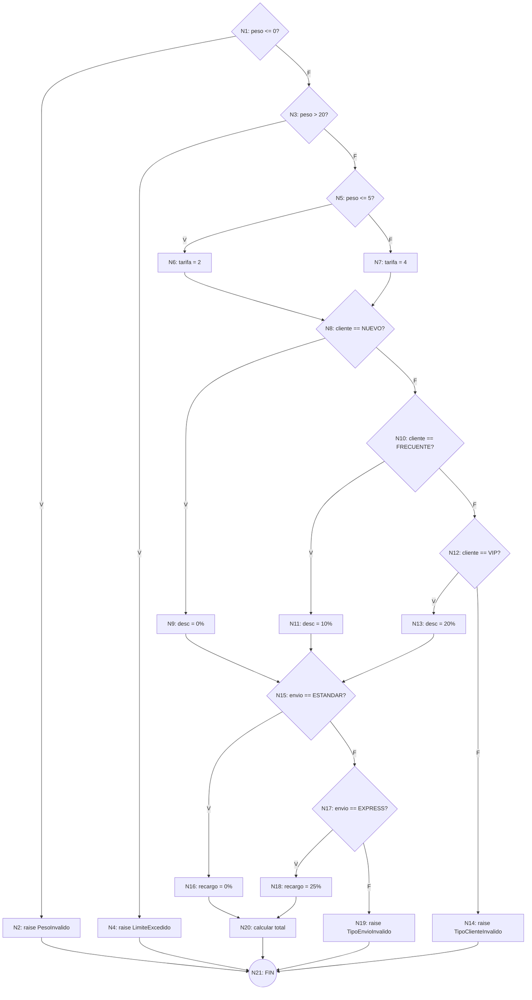

# Plan de Pruebas de Caja Blanca

**Función bajo prueba:** `calcular_cotizacion(peso, tipo_cliente, tipo_envio)`
**Archivo:** `principal/modulos/cotizaciones/services/calculadora_service.py`
**Pruebas automatizadas:** `tests/unit/cotizaciones/test_calculadora_caja_blanca.py` (`pytest -m caja_blanca`)

Los nodos `[N1]..[N21]` están marcados como comentarios en el código fuente para que se pueda seguir el grafo línea por línea.

---

## 1. Tabla de nodos

| Nodo | Tipo | Instrucción |
|---|---|---|
| N1 | Decisión D1 | `if peso <= 0` |
| N2 | Proceso | `raise PesoInvalidoError` |
| N3 | Decisión D2 | `if peso > 20.00` |
| N4 | Proceso | `raise LimiteExcedidoError` |
| N5 | Decisión D3 | `if peso <= 5.00` |
| N6 | Proceso | `tarifa_kg = 2.00` |
| N7 | Proceso | `tarifa_kg = 4.00` |
| N8 | Decisión D4 | `if tipo_cliente == NUEVO` |
| N9 | Proceso | `descuento = 0%` |
| N10 | Decisión D5 | `elif tipo_cliente == FRECUENTE` |
| N11 | Proceso | `descuento = 10%` |
| N12 | Decisión D6 | `elif tipo_cliente == VIP` |
| N13 | Proceso | `descuento = 20%` |
| N14 | Proceso | `raise TipoClienteInvalidoError` |
| N15 | Decisión D7 | `if tipo_envio == ESTANDAR` |
| N16 | Proceso | `recargo = 0%` |
| N17 | Decisión D8 | `elif tipo_envio == EXPRESS` |
| N18 | Proceso | `recargo = 25%` |
| N19 | Proceso | `raise TipoEnvioInvalidoError` |
| N20 | Proceso | cálculo de subtotal, descuento, recargo, total |
| N21 | Fin | salida de la función (return o excepción) |

---

## 2. Grafo de Flujo de Control (CFG)



> GitHub dibuja este diagrama automáticamente. Para el informe en Word se puede exportar como imagen desde https://mermaid.live pegando el bloque.

---

## 3. Cálculo de la Complejidad Ciclomática V(G)

Se calcula por los tres métodos para comprobar que coinciden.

### Método 1: Aristas y nodos — `V(G) = E − N + 2`

Conteo de aristas (E):

| Desde | Hacia | # |
|---|---|---|
| N1 | N2, N3 | 2 |
| N3 | N4, N5 | 2 |
| N5 | N6, N7 | 2 |
| N6, N7 | N8 | 2 |
| N8 | N9, N10 | 2 |
| N10 | N11, N12 | 2 |
| N12 | N13, N14 | 2 |
| N9, N11, N13 | N15 | 3 |
| N15 | N16, N17 | 2 |
| N17 | N18, N19 | 2 |
| N16, N18 | N20 | 2 |
| N2, N4, N14, N19, N20 | N21 | 5 |
| **Total** | | **28** |

- E = 28 aristas
- N = 21 nodos

**V(G) = 28 − 21 + 2 = 9**

### Método 2: Nodos predicado — `V(G) = P + 1`

Nodos de decisión (cada uno con 2 salidas): N1, N3, N5, N8, N10, N12, N15, N17 → **P = 8**

**V(G) = 8 + 1 = 9**

### Método 3: Regiones del grafo

Las regiones cerradas que forma el grafo plano más la región exterior suman **9**.

### Interpretación

V(G) = 9 significa que existen **9 caminos independientes** y que se necesitan **mínimo 9 casos de prueba** para ejecutar cada sentencia y cada rama al menos una vez. Un valor entre 1 y 10 se considera de **riesgo bajo** (código simple y mantenible).

---

## 4. Caminos independientes y casos de prueba

| Camino | Recorrido | Entrada (peso, cliente, envío) | Resultado esperado | Prueba automatizada |
|---|---|---|---|---|
| C1 | N1 → N2 → N21 | 0, NUEVO, ESTANDAR | `PesoInvalidoError` | `test_C1_peso_cero_o_negativo_es_rechazado` |
| C2 | N1 → N3 → N4 → N21 | 20.01, NUEVO, ESTANDAR | `LimiteExcedidoError` | `test_C2_peso_mayor_a_20_es_rechazado` |
| C3 | N1 → N3 → N5 → N6 → N8 → N9 → N15 → N16 → N20 → N21 | 2.00, NUEVO, ESTANDAR | total = 9.00 | `test_C3_camino_base_ligero_nuevo_estandar` |
| C4 | N1 → N3 → N5 → **N7** → N8 → N9 → N15 → N16 → N20 → N21 | 10.00, NUEVO, ESTANDAR | total = 45.00 | `test_C4_tramo_pesado` |
| C5 | ... N8 → **N10 → N11** → N15 → N16 → N20 → N21 | 2.00, FRECUENTE, ESTANDAR | total = 8.10 | `test_C5_cliente_frecuente` |
| C6 | ... N8 → N10 → **N12 → N13** → N15 → N16 → N20 → N21 | 2.00, VIP, ESTANDAR | total = 7.20 | `test_C6_cliente_vip` |
| C7 | ... N8 → N10 → N12 → **N14** → N21 | 2.00, PREMIUM, ESTANDAR | `TipoClienteInvalidoError` | `test_C7_tipo_cliente_invalido` |
| C8 | ... N9 → N15 → **N17 → N18** → N20 → N21 | 2.00, NUEVO, EXPRESS | total = 11.25 | `test_C8_envio_express` |
| C9 | ... N9 → N15 → N17 → **N19** → N21 | 2.00, NUEVO, AEREO | `TipoEnvioInvalidoError` | `test_C9_tipo_envio_invalido` |

C3 es el **camino base**; cada camino siguiente cambia exactamente **una** decisión respecto al base (en negrita), por eso son linealmente independientes.

### Cálculos de verificación

- C3: subtotal = 5.00 + 2 × 2.00 = **9.00**; sin descuento ni recargo → **9.00**
- C4: subtotal = 5.00 + 10 × 4.00 = **45.00** → **45.00**
- C5: 9.00 − 10% (0.90) = **8.10**
- C6: 9.00 − 20% (1.80) = **7.20**
- C8: 9.00 + 25% (2.25) = **11.25**

---

## 5. Cómo ejecutar

```bash
pytest -m caja_blanca --no-cov      # solo los 9 caminos
pytest                              # todo + reporte de cobertura
```

Resultado: 9/9 caminos ejecutados, cobertura de `calculadora_service.py` = 100 % de líneas y 100 % de ramas (16/16).
